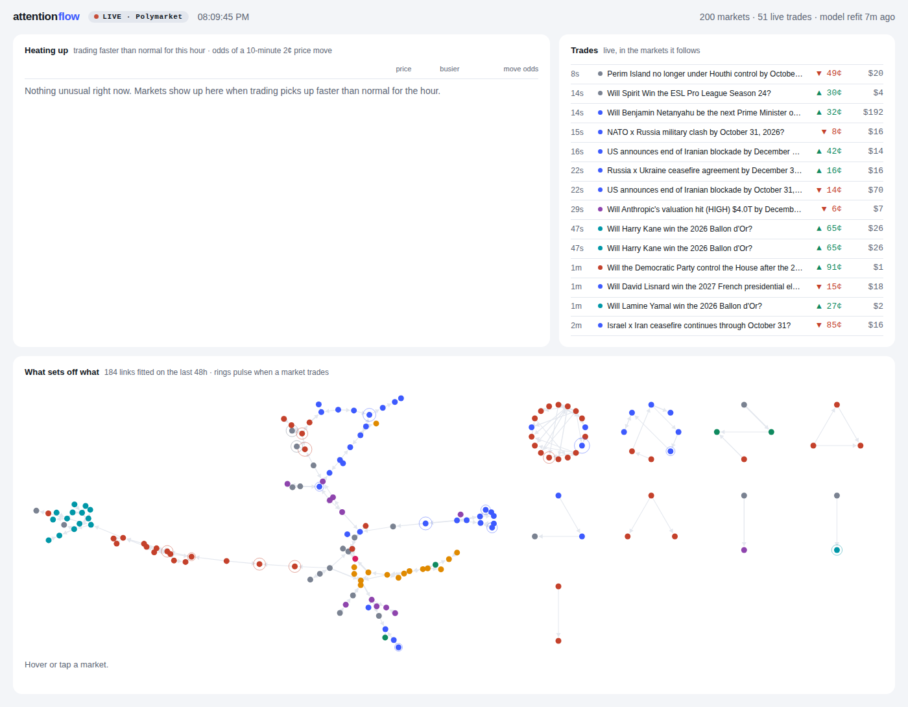

# attention flow

A live view of where traders' attention is going on [Polymarket](https://polymarket.com), and what it sets off.

It follows the busiest markets trade by trade and keeps two models fitted on the last two days:

- **Most likely to move:** the markets the model gives the best odds of a 2¢ price move in the next 10 minutes, compared with a normal moment, and which related markets are driving it. This held up out of sample in the last four months of a year of real trades, but not earlier in the year (see [Real data](#real-data)).
- **What sets off what:** which markets' trading kicks off trading in other markets, and how fast.

## Try it

You need [Go](https://go.dev/dl/) 1.24 or newer. No API keys, no accounts: everything comes from Polymarket's public endpoints.

```sh
git clone https://github.com/gauri-sharmaa/attention-flow
cd attention-flow
go run ./cmd/attnflow serve
```

Open http://localhost:8080. It spends a minute or two loading recent trades and fitting, then goes live. `-markets 60 -hours 12` warms up faster, and `-addr :9000` changes the port.



**[Watch the 2-minute demo](docs/demo.mp4)**: how it works, what each panel means, and what the research found.

## Real data

A year of every trade on 1,205 Polymarket markets, Oct 2025 to Oct 2026: 24 million trades, including markets that resolved during the year. Every test is walk-forward: fit on one 30-day period, scored on the next, which the model never saw. That gives 11 test months, or 12 periods for the tests that don't fit a model. Each test has a placebo that shifts streams by whole days, keeping their daily rhythm and destroying real timing.

| Question | Method | Test months that pass | Answer |
|---|---|---|---|
| Does trading activity predict price moves? | Hawkes, trades → 2¢ moves | 4 of 11 (Jun–Oct 2026); beats the placebo in 10 of 11 | **Recently, yes; earlier in the year, no** |
| Does trading in one market set off related markets? | Hawkes, trade times | 6 of 11 | **Some months** |
| Do some prices move before related prices? | Hoffmann–Rosenbaum–Yoshida | 12 of 12 (27–113 linked pairs a month, 1–4 by chance) | **Linked, but the leader flips** |
| Is the order-flow signal profitable? | paper trading, 1¢ per side | 0 of 11 (−$219k on 20,118 trades) | **No** |
| Does news / Reddit / HN buzz lead trading? | event study, 1,743 surges (90 days) | – | **No** |

A month passes when the held-out gain (log-likelihood per event, in nats) beats both zero and the placebo.

- **Activity → price moves:** gains of +0.10 to +0.20 per move from June to October 2026, against placebos of −0.13 to −0.54. From November to June the gain was negative every month (−0.01 to −0.19), though still above the placebo in six of those seven months. So the timing carries information all year, but only recently did it beat a model of price moves alone. The 90-day run covered only Jul–Oct, which is why it looked like a clean yes.
- **Spreading between markets:** clearly positive in Nov–Dec 2025 and Jul–Oct 2026 (+0.03 to +0.12), flat or negative in between.
- **Prices:** linked markets move together every month, but the leader repeats from one month to the next only 47% of the time, a coin flip. The 61 pairs with a lead that lasts are almost all the same question at different dates or strikes, where the busier contract reprices first.
- **Trading:** order flow has a little information before costs: +$13.6k over the year, positive in 10 of 11 months. A 1¢ cost per side turns that into −$219k.
- **Buzz:** around news and Reddit surges, trading in the related markets stays flat before and after.

Scorecards: [docs/results](docs/results) (`real-365d-*` for the year, `real-90d-*` for the first run).

Bars blur timing, so the methods that work use raw event times:

- **Hawkes processes** (`internal/hawkes`): each trade raises the near-term rate of more trades in its own and related markets, and the fitted excitation matrix is the lead-lag graph. Same-second events never excite each other: a trade and the price move it causes are simultaneous, and blocking that cut the first cross-market estimate from +0.104 to +0.030. A shared hour-of-week background stops US daytime from passing for a link.
- **Hoffmann–Rosenbaum–Yoshida lead-lag** (`internal/leadlag`): covariance of price changes over overlapping observation intervals, scanned across lags, with a p-value from 99 shuffles.
- **Event study** (`attnflow eventstudy`): trading around each surge against the same clock time on other days.

Methods follow Bacry, Mastromatteo & Muzy, [Hawkes processes in finance](https://arxiv.org/abs/1502.04592); Xu, Farajtabar & Zha, [Learning Granger causality for Hawkes processes](http://proceedings.mlr.press/v48/xuc16.pdf); and Hoffmann, Rosenbaum & Yoshida, [Estimation of the lead-lag parameter from non-synchronous data](https://arxiv.org/abs/1303.4871).

## Research commands

Go 1.24; the only dependency is a websocket library.

```sh
go build -o attnflow ./cmd/attnflow

./attnflow sim                                   # simulate 2 weeks with an answer key
./attnflow replay -truth data/sim/truth.json     # score everything
./attnflow serve                                 # live Polymarket dashboard at localhost:8080
./attnflow serve -sim                            # replay the simulator instead
./attnflow export -out site                      # static simulator dashboard for hosting

./attnflow polytrades -days 365 -n 400 -closed 1000 -bars=false -out data/pmt365   # a year of every trade, incl. resolved markets (hours; resumable)
./attnflow hawkes -dir data/pmt365 -folds 11      # does trading spread between markets? (walk-forward)
./attnflow hawkes -dir data/pmt365 -moves 0.02 -folds 11      # does trading predict price moves?
./attnflow leadlag -dir data/pmt365 -periods 12   # which prices move first
./attnflow backtest -dir data/pmt365 -periods 12  # paper-trade the order-flow signal
./attnflow eventstudy                            # does buzz lead trading?
./attnflow outside                               # news, Reddit, Hacker News mentions
./attnflow hawkes -extra data/pmt/outside-news.csv,data/pmt/outside-reddit.csv,data/pmt/outside-hn.csv
```

Real data (Wikipedia hourly pageviews for the topics in [data/universe.txt](data/universe.txt)):

```sh
./attnflow fetch -contact you@example.com -days 90
./attnflow replay -events data/wiki/events.csv -text data/wiki/text.json -bar 3600
./attnflow serve  -sim -events data/wiki/events.csv -text data/wiki/text.json -bar 3600 -label wikipedia
```

Any other feed (Kaito mindshare, Google Trends, attention-market prices) only needs to write the same `ts,entity,value` CSV.

## Layout

```
cmd/attnflow       CLI
internal/engine    streaming inference: factors, RLS forecasts, lead-lag graph, shocks
internal/sim       simulator with a planted answer key
internal/replay    out-of-sample scoring, oracle ceiling
internal/semantic  TF-IDF candidate graph
internal/stats     online estimators (EW, robust median/MAD, RLS)
internal/ring      lock-free SPSC queue for ingest
internal/source    Wikipedia, Polymarket, Bluesky, GDELT, Reddit, Hacker News
internal/hawkes    multivariate Hawkes processes on raw event times
internal/leadlag   Hoffmann–Rosenbaum–Yoshida lead-lag for asynchronous prices
internal/server    SSE server + dashboard
```
